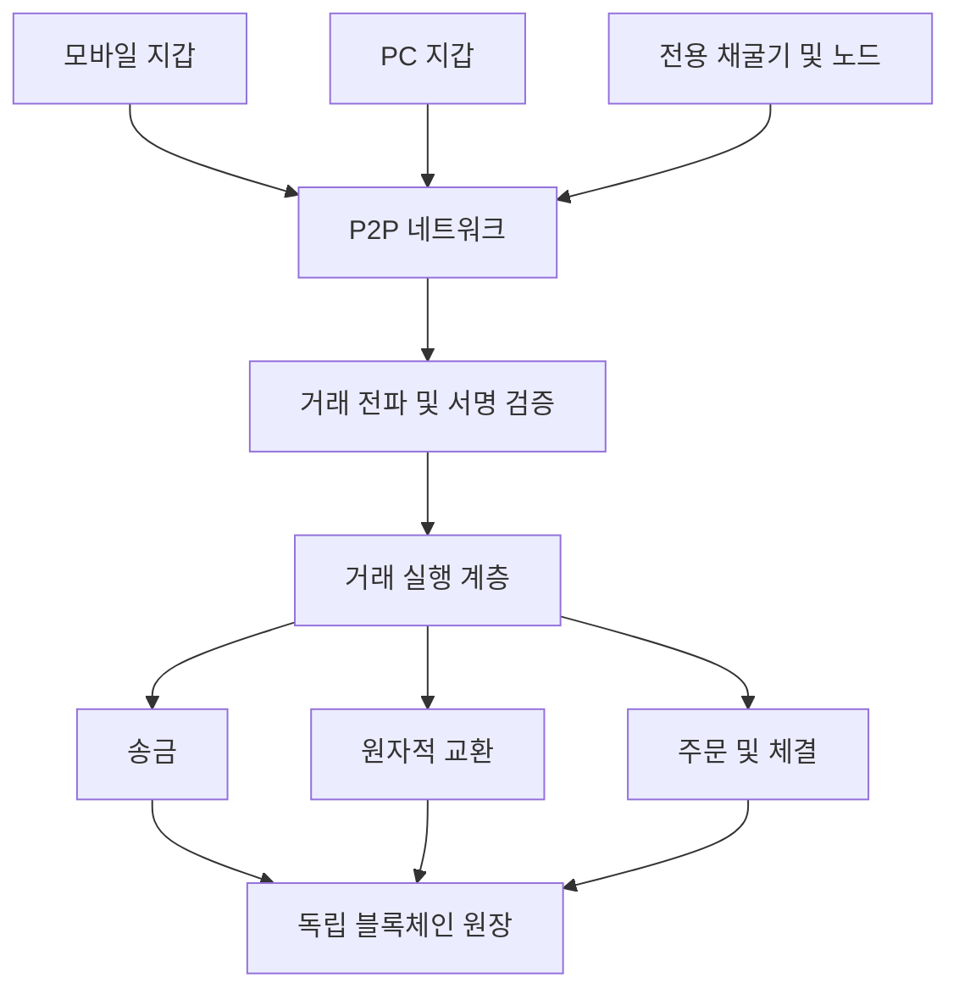
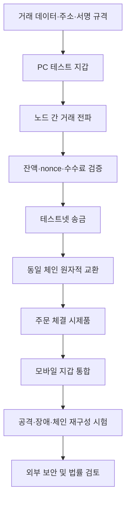

# ORQUBE Native Exchange Network — 자체 거래 시스템 기술 설계안

> ORQUBE Universal Trust Infrastructure | 2026-11-04 | 자체 거래 시스템 기술 설계

## 1. 목표

독립 블록체인에 비수탁형 P2P 송금, 원자적 교환 및 선택적 탈중앙 주문 체결 계층을 순차적으로 구축한다. 사용자는 웹사이트 없이 모바일·PC 지갑으로 거래를 서명할 수 있다. 단, 거래 전파와 확정에는 네트워크 연결이 필요하다.

## 2. 전체 시스템 구성도



웹사이트는 선택적인 조회 인터페이스이며, 개인키는 사용자 지갑에서 관리한다.

## 3. 거래 기능의 단계별 구현

| 단계 | 기능 | 구현 핵심 |
|---|---|---|
| 1 | 지갑 간 직접 송금 | 주소, 개인키 서명, nonce, 잔액 및 수수료 검증 |
| 2 | 동일 체인 자산 교환 | 한 상태 전이에서 양쪽 자산 이전을 원자적으로 실행 |
| 3 | 탈중앙 주문 체결 | 주문 생성·취소, 가격·수량, 부분 체결, 수수료 |
| 4 | 타 체인 교환 연구 | HTLC 등 별도 교차체인 프로토콜 및 실패 복구 설계 |

**주의:** 동일 체인 원자적 교환과 서로 다른 블록체인 사이의 원자적 교환은 기술적으로 구분해야 한다.

## 4. 거래 유효성 및 원자성

거래 유효성의 개념식:

```text
V(T) = S(T) AND B(T) AND N(T) AND R(T)
S: 전자서명 유효성
B: 잔액 충분성
N: nonce 및 재전송·중복 거래 방지
R: 거래 실행 규칙 충족
```

예시: A가 X자산 10단위를 지급하고 B가 Y자산 20단위를 지급한다.

```text
ΔA = (-10 X, +20 Y)
ΔB = (+10 X, -20 Y)
Commit = (모든 조건 충족) ? 양쪽 동시 반영 : 전체 취소
```

이것은 단일 체인 내의 개념적 상태 전이 예시이며, 구현에서는 가스·수수료·동시성·재진입·롤백을 추가 검증한다.

## 5. 기존 독립체인 설계와 연결

| 항목 | 연구·설계 기준 |
|---|---|
| 발행 상한 | 12,000,000 |
| 사전 발행 | 0 |
| 목표 블록 간격 | 120초 |
| 반감 주기 | 4년 |
| 합의 모델 | OVF-PoW (연구 중) |
| 거래 모델 | 비수탁형 P2P, 원자적 교환 |
| 서명 | 양자내성 서명 후보 검토 |
| 거래 기록 | 독립 블록체인 원장 |

120초 목표 블록 간격은 확정 보장을 뜻하지 않는다. 체인 재구성, 이중지불, 고액 거래 확인 정책을 별도로 검증해야 한다. OVF-PoW의 안전성은 아직 입증되지 않았다.

## 6. 개발 흐름도



## 7. 초기 개발 일정(가정)

| 기간 | 목표 |
|---|---|
| 1–2주 | 거래 프로토콜 명세 |
| 3–6주 | PC 지갑 및 송금 테스트넷 |
| 7–10주 | 교환 엔진 시제품 |
| 11–16주 | 모바일 통합 및 보안 시험 |

위 일정은 초기 시제품의 예시이며 합의 연구, 외부 감사 및 메인넷 출시 기간을 포함하지 않는다.

## 8. 보안과 법적 고려

- 개인키는 서버에 수집하지 않는 비수탁형 설계를 우선한다.
- 양자내성 서명은 NIST ML-DSA(FIPS 204) 등을 검토하되 전체 시스템의 양자 안전성을 단정하지 않는다.
- 이중지불, 체인 재구성, 거래 검열, 네트워크 분할, 악의적 노드 및 거래 재생 공격을 시험한다.
- 한국 내 실제 가상자산 매매·교환·중개 서비스는 사업자 신고 및 관련 법령 적용 가능성을 별도 검토한다.
- 기존 ORBS와 신규 독립코인의 발행·회계·교환 정책을 분리한다.

## 9. 구현 기술 구조

핵심 노드 구현 언어는 Go 또는 Rust를 검토하며 모바일 지갑은 Flutter 기반으로 구성한다. 거래 프로토콜·테스트넷 개발과 합의 엔진 통합을 단계적으로 수행하고, 각 단계의 보안성을 검증한다.

**문서 구분:** 독립 블록체인 거래 계층의 기술 설계. 구현·검증 현황은 별도로 관리한다.
